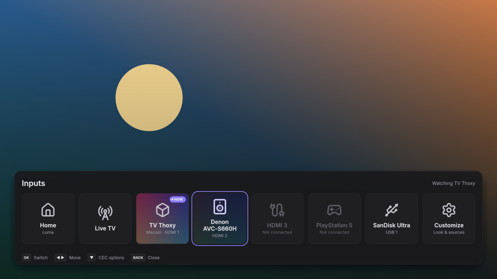

<p align="center">
  
</p>

<h1 align="center">Inputs</h1>

<p align="center">A fast, native input picker for rooted LG webOS TVs, built with Rust and egui.</p>

<p align="center">
  
  
</p>

## Highlights

- **A real overlay**: it floats over the picture or the app in front instead of replacing it,
  wakes the TV from the screen saver, and opens in a fraction of a second.
- **Inputs that say what they are**: HDMI inputs named after the device plugged in (HDMI-CEC
  name and maker, e.g. *Denon AVC-S670H*), with **live previews** of the source being watched and
  the last picture of the others.
- **CEC options per input**: power the device on or off, open its home screen, menu or info.
- **Everything in one list**: Live TV, USB storage, DLNA media servers, and a Home entry that
  follows the home in use (LG, [Luma](https://github.com/ecklf/lg-luma) or Glasshouse Home).
- **Yours to shape**: row, grid, list or docked sidebar; nine positions; eight themes and accent
  colours; sizes, opacity, corners, icons; rename, hide and reorder sources; French and English.
- **The remote's Source key opens it** (and, on remotes without one, a short press on Multikey,
  a long press staying LG's accessibility), reversible from its own settings.
- **Small**: a 2.1 MB binary (Thumb-2, size-optimised standard library, fonts and icons trimmed).

## Tested TVs

| TV | Model | webOS | Firmware | Notes |
|---|---|---|---|---|
| LG OLED C1 (2021) | `OLED55C16LA` | webOS 6 (6.5.3) | 03.53.45 | Previews need the capture access option (Customize). Luma as Home (executable method). |
| LG QNED86 (2025) | `55QNED86A6A` | webOS 25 (10.3.2) | 33.31.75 | Remote without a Source key: Multikey opens the picker. Luma as Home (manifest method). |

Both are rooted with the [Homebrew Channel](https://github.com/webosbrew/webos-homebrew-channel).
The binary is armv7 soft-float; the key takeover uses the compositor's JavaScript key filters, so
webOS 11 (native filters) is not supported yet.

## Install

Add this repository to the Homebrew Channel (Settings → Repositories), then install **Inputs**:

```
https://git.thoxy.xyz/api/packages/thoxy/generic/lg-c1-source/latest/repo.json
```

Each release then shows up as an update. Every release also carries the `.ipk` to install by hand.

## Build

Needs the pinned nightly in `rust-toolchain.toml` and Node (for the SDK scripts):

```sh
cargo run                          # desktop preview with mock inputs
node tools/setup-webos-sdk.mjs     # once: the webOS NDK (~300 MB) and SDL-webOS into .build/
tools/build-webos.sh               # the TV binary
python3 tools/package.py           # dist/com.thoxy.sourcepicker_<version>_arm.ipk
tools/deploy.sh 192.168.1.85       # build, install over ssh and launch on a TV
```

The preview can script itself, for checking the UI without a TV:

```sh
cargo run -- --screenshot shot.png --keys left,left,left,ok --size 1920x1080
```

## Use

Press **Source** (or **Multikey**), move with the arrows, **OK** to switch. On an HDMI input,
**Down** (**Right** in a list) opens its CEC options. **Customize** is the last tile.

As root on the TV:

```sh
source-picker --takeover on|off|status        # the Source key opens this picker, or LG's again
source-picker --capture-access on|off|status  # webOS 6: allow the video previews
```

## Configure

Everything is in **Customize**, by section: General, Appearance, Layout, What to show, Behaviour,
Remote and Sources. The settings are kept in `/media/developer/lg-c1-source/config.json` (every
field optional), which survives reinstalls.

## Releases

`tools/release.sh X.Y.Z` sets the version, writes `CHANGELOG.md` from the commits since the last
tag, commits and tags; `git push && git push origin vX.Y.Z` then runs
[`.forgejo/workflows/release.yml`](.forgejo/workflows/release.yml). It builds, packages, writes the
release notes and the Homebrew Channel `repo.json` automatically, publishes the Forgejo release,
and updates the repository URL above. [`.forgejo/workflows/ci.yml`](.forgejo/workflows/ci.yml)
builds every push to `main`.

Repository settings: variable `FORGEJO_RUNNER` (runner label, default `docker`); secret
`FORGEJO_TOKEN` (`write:repository`, `write:package`) if the job's own token cannot publish
packages.

## License

MIT © 2026 Thoxy. See [LICENSE](LICENSE); third-party notices are in [NOTICE](NOTICE). The webOS
Luna bridge, key decoding and libc shim are ported from [Luma](https://github.com/ecklf/lg-luma)
(MIT). The theme tokens follow PhotoCraft's (MIT OR Apache-2.0). Inter is under the SIL Open Font
License 1.1 and the Lucide icons under ISC.
