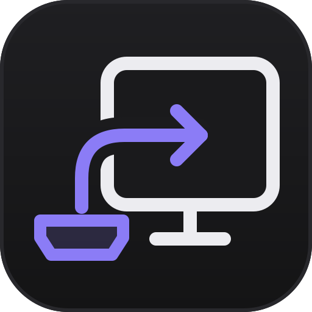
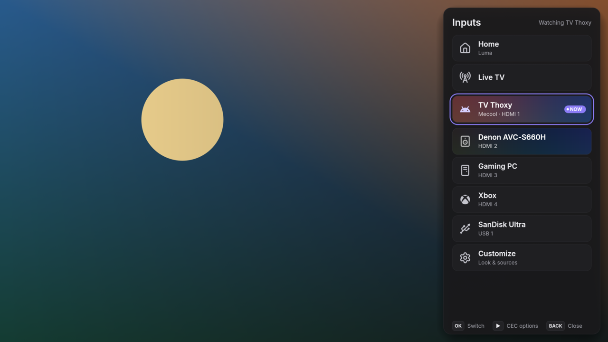

<p align="center">
  
</p>

<h1 align="center">Outpick</h1>

<p align="center">A fast, native input picker for rooted LG webOS TVs, built with Rust and egui.</p>

<p align="center">
  <a href="https://git.thoxy.xyz/thoxy/outpick">Repository</a> ·
  <a href="https://git.thoxy.xyz/thoxy/outpick/releases">Releases</a> ·
  <a href="https://git.thoxy.xyz/thoxy/outpick/issues">Issues</a> ·
  <a href="https://git.thoxy.xyz/thoxy/outpick/actions">CI</a>
</p>

<p align="center">
  
  
</p>

## Highlights

- **A real overlay**: it floats over the picture or the app in front instead of replacing it,
  wakes the TV from the screen saver, and opens in a fraction of a second.
- **Inputs that say what they are**: HDMI inputs named after the device plugged in (HDMI-CEC
  name and maker, e.g. *Denon AVC-S670H*), with **live previews** of the source being watched and
  the last picture of the others.
- **CEC options per input**: power the device on or off, open its home screen, menu or info.
- **Everything in one list**: Live TV, USB storage, DLNA media servers, and a Home entry that
  follows the home in use (LG, [Luma](https://github.com/ecklf/lg-luma) or Glasshouse Home).
- **Yours to shape**: row, grid, list or docked sidebar; nine positions; eight themes and eleven
  accent colours; sizes, opacity, corners, icons; rename, hide and reorder sources; French and
  English.
- **An on-screen clock** in seven styles, placed anywhere on the screen.
- **The remote's Source key opens it** (and, on remotes without one, a short press on Multikey,
  a long press staying LG's accessibility), reversible from its own settings.
- **Quick switch**: pressing Source again while the picker is open moves to the next input, and
  the TV switches to it after a countdown (1 to 10 s, set in Customize → Remote).
- **Small**: a 1.9 MB binary (Thumb-2, size-optimised standard library, fonts and icons trimmed).

## Tested TVs

| TV | Model | webOS | Firmware | Notes |
|---|---|---|---|---|
| LG OLED C1 (2021) | `OLED55C16LA` | webOS 6 (6.5.3) | 03.53.45 | Previews need the capture access option (Customize). Luma as Home (executable method). |
| LG QNED86 (2025) | `55QNED86A6A` | webOS 25 (10.3.2) | 33.31.75 | Remote without a Source key: Multikey opens the picker. Luma as Home (manifest method). |

Both are rooted with the [Homebrew Channel](https://github.com/webosbrew/webos-homebrew-channel).
The binary is armv7 soft-float; the key takeover uses the compositor's JavaScript key filters, so
webOS 11 (native filters) is not supported yet.

## Install

Add this repository to the Homebrew Channel (Settings → Repositories), then install **Outpick**:

```
https://git.thoxy.xyz/thoxy/outpick/raw/branch/hbc/repo.json
```

Each release then shows up as an update. Every release also carries the `.ipk` to install by hand.
The picker itself runs without root; root (a rooted TV with the Homebrew Channel) is needed for the
Source key takeover, the video previews on webOS 6 and the settings-folder permission fix.

Or install a release's `.ipk` by hand from
[git.thoxy.xyz/thoxy/outpick/releases](https://git.thoxy.xyz/thoxy/outpick/releases).

**Coming from "Inputs"** (`com.thoxy.sourcepicker`, the name before Outpick): install Outpick and
open it once. It takes over the Source key filter, the capture access and the settings
(`/media/developer/lg-c1-source/config.json` is read when Outpick has none yet); then uninstall
the old app.

**Before uninstalling**, give the keys back: turn them off in Customize → Remote, or run
`outpick --uninstall` as root. If the app is removed without that, a boot hook puts LG's
Source key back at the next start.

## Build

Needs the pinned nightly in `rust-toolchain.toml` and Node (for the SDK scripts):

```sh
cargo run                          # desktop preview with mock inputs
node tools/setup-webos-sdk.mjs     # once: the webOS NDK (~300 MB) and SDL-webOS into .build/
tools/build-webos.sh               # the TV binary
python3 tools/package.py           # dist/com.thoxy.outpick_<version>_arm.ipk
tools/deploy.sh 192.168.1.85       # build, install over ssh and launch on a TV
```

The preview can script itself, for checking the UI without a TV:

```sh
cargo run -- --screenshot shot.png --keys left,left,left,ok --size 1920x1080
```

## Use

Press **Source** (or **Multikey**), move with the arrows, **OK** to switch. On an HDMI input,
**Down** (**Right** in a list) opens its CEC options. **Customize** is the last tile.

As root on the TV:

```sh
outpick --takeover on|off|status        # the Source key opens this picker, or LG's again
outpick --capture-access on|off|status  # webOS 6: allow the video previews
outpick --uninstall                     # undo both, remove the boot hook and the previews
```

Either option installs a small boot hook, `/var/lib/webosbrew/init.d/70-outpick` (a copy,
not a link into the app). At each boot it puts the takeover back if the TV lost it, and once the
app has been uninstalled it cleans up after it by itself: our key filter out of the compositor's
chain (LG's filters left as they are), the app off the capture whitelist (other entries kept),
`/var/lib/outpick` and the previews deleted, then the hook itself. Only the settings,
`config.json`, are kept for a reinstall. `--uninstall` does the same at once, before removing the app.

## Configure

Everything is in **Customize**, by section: General, Appearance, Layout, What to show, Behaviour,
Clock, Remote and Sources. The settings are kept in `/media/developer/outpick/config.json` (every
field optional), which survives reinstalls.

## Releases

`tools/release.sh X.Y.Z` sets the version, writes `CHANGELOG.md` from the commits since the last
tag, commits and tags; `git push && git push origin vX.Y.Z` then runs
[`.forgejo/workflows/release.yml`](.forgejo/workflows/release.yml). It builds, packages, writes the
release notes and the Homebrew Channel `repo.json` automatically, publishes the Forgejo release,
and commits the feed to the orphan branch `hbc` (the repository URL above; its links point at the
tagged release). [`.forgejo/workflows/ci.yml`](.forgejo/workflows/ci.yml) builds every push to
`main` ([runs](https://git.thoxy.xyz/thoxy/outpick/actions)) and checks that packaging twice gives the same `.ipk`: `tools/package.py` is reproducible
(timestamps from `SOURCE_DATE_EPOCH`, else the last commit).

Repository settings: variable `FORGEJO_RUNNER` (runner label, default `docker`); secret
`FORGEJO_TOKEN` (`write:repository`) only if the job's own token cannot publish releases. The
job's token pushes the `hbc` branch.

## License

MIT © 2026 Thoxy. See [LICENSE](LICENSE); third-party notices are in [NOTICE](NOTICE). The webOS
Luna bridge, key decoding and libc shim are ported from [Luma](https://github.com/ecklf/lg-luma)
(MIT). The theme tokens follow PhotoCraft's (MIT OR Apache-2.0). Inter is under the SIL Open Font
License 1.1, the Lucide icons under ISC and the Simple Icons brand glyphs under CC0 (the logos
are trademarks of their owners).
